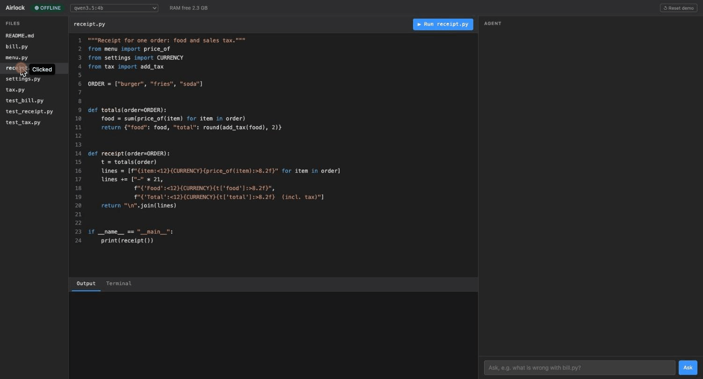

# Airlock

**An offline AI coding agent that fixes bugs in a sealed container — only with your approval.**



<sub>Ping fails (no network) · ask in plain English · fix lands in a different file than the symptom · approve ·
$166.50 → $19.98. The ~90 s model wait is cut.</sub>

Ask in plain English what is wrong with your code. Airlock reads the repo, explains the bug, and proposes a
minimal fix, all with a **local model** (Qwen 3.5 4B via Ollama). Nothing leaves your machine.

- **Offline:** no cloud APIs, no telemetry; the model client only talks to `127.0.0.1`.
- **Cross-file fixes:** finds the cause even when it is in a different file than the symptom.
- **Self-checked:** every fix is tested on a scratch copy before you see it.
- **Your call:** nothing changes until you click Approve.

## Quick start

Needs Python 3.12+, git, and [Ollama](https://ollama.com) with the model pulled (one-time, while online):

```bash
ollama pull qwen3.5:4b                                   # 3.3 GB
python3 -m venv .venv && .venv/bin/pip install pytest
./scripts/reset_demo.sh                                  # demo repo at demo/work
bin/airlock-ui --repo demo/work --reset-script scripts/reset_demo.sh
# open http://localhost:8080
```

Prefer a terminal? `bin/airlock --repo demo/work "what is wrong with bill.py?"`.
For network isolation on Linux, run it in the [sealed container](docs/container.md):
`sudo ./scripts/container.sh up`.

## Try the demo

The demo is a small restaurant app (9 files) with two bugs:

| Ask | You see | Airlock fixes |
| --- | --- | --- |
| "what is wrong with bill.py?" | each person pays **$320.00** | `bill.py` |
| "the receipt total is way too high" | receipt total **$166.50** | **`tax.py`**, a different file |

Approve, click ▶ Run, and the numbers are right ($23.00 and $19.98). **↺ Reset demo** starts over.

## How it works

```
You ─► question or fix? ─► read repo ─► local model ─► edits ─► self-check on a copy ─► you approve ─► apply + test
```

The model returns small SEARCH/REPLACE edits (up to 3 files) instead of rewriting files. Airlock validates them
with git, runs the tests on a scratch copy, and gives the model one more try if the fix fails. Details:
[design](docs/design.md).

## Results

13 small buggy repos, each failing its tests before the fix ([details](docs/eval.md)):

| Design | Fixed |
| --- | --- |
| One file per fix, model rewrites the whole file | 7/10 |
| Small edits across files | 9/10 |
| + self-check on a scratch copy | 12/12 |
| + fix only what was asked (current) | **12/13** |

## Safety at a glance

- Nothing is written until you approve; the self-check runs on a throwaway copy.
- File access stays inside the repo; secrets, `.git` and symlink escapes are blocked.
- No shell: the model only returns edits; tests run as a fixed command.
- Optional container: no route out, non-root, read-only, all capabilities dropped.
- Every run is recorded in a redacted audit log.

## Limitations

- Small Python repos with pytest (~12k characters of code are read).
- A 4B model on a CPU takes about 1–2 minutes per fix, and it can still be wrong; the diff review is yours.
- The container shares the host kernel, and it needs Linux.
- One run per eval case: a sanity check, not a benchmark.

## More

[Container and air-gapped runs](docs/container.md) · [Design](docs/design.md) ·
[Evaluation](docs/eval.md) · [Offline tests](docs/offline.md)
